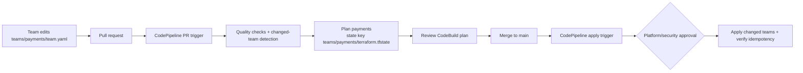

# team-infra: self-service AWS baseline for product teams

Each team declares its S3 buckets in **one YAML file it owns**. The platform turns that file into an IAM role and S3 buckets, using **one state file per team**. A CodePipeline PR pipeline shows the plan, and merging starts a separately approved apply pipeline. Adding team #301 is a new directory. It needs no changes to platform code.

```
.
├── teams/                      # ← the only place product teams edit
│   ├── _template/team.yaml
│   ├── payments/team.yaml
│   └── ledger/team.yaml
├── modules/team-baseline/      # reusable module: 1 IAM role + N buckets, with guardrails
│   └── tests/{unit,integration}
├── stack/                      # generic root module: reads teams/<t>/team.yaml and calls the module
│   ├── backend.hcl             # shared backend settings (the key is injected per team)
│   └── tests/                  # contract tests: team file → module wiring
├── schema/team.schema.json     # contract for team files (CI and in-editor validation)
├── scripts/
│   ├── tf.sh                   # run terraform for one team against its own state
│   ├── detect-changed-teams.sh # commit range → affected teams / offboarded teams
│   ├── validate-team-files.sh  # schema check and directory-name check
│   └── public-bucket-gate.sh   # plan policy check: what becomes public?
├── buildspec/                  # CodeBuild quality, plan, and apply commands
├── bootstrap/                  # one-off: state/artifact buckets, CodePipeline, CI roles, team boundary
└── .github/
  └── CODEOWNERS              # each team owns teams/<team>/
```



---

## Onboarding a team (self-service)

1. Copy `teams/_template/` to `teams/<team>/`. The team name is 3–24 lowercase letters or digits.
2. Edit `team.yaml`. Editors with the YAML extension autocomplete and validate it against the schema.

   ```yaml
   # yaml-language-server: $schema=../../schema/team.schema.json
   team: payments                      # must equal the directory name
   owner: payments-team@sumup.example   # Owner tag
   cost_center: CC-1001                # CostCenter tag
   buckets:
     invoices:
       visibility: private             # required: public | private; retention defaults to 90 days
     public-assets:
       visibility: public              # requires platform/security approval before apply
       retention_days: 365             # optional Compliance retention override
   ```
3. Add `/teams/<team>/ @sumup/<github-team>` to `.github/CODEOWNERS`.
4. Open a PR and review the plan in the CodeBuild logs linked from the CodePipeline execution.
5. After merge, the apply pipeline waits for platform approval, then provisions the `sumup-team-<team>` role and buckets named `sumup-<team>-<bucket>`.

Platform reviews the first PR because it touches CODEOWNERS. After that, only the team's own reviewers approve changes to its file.

Local preview (needs AWS credentials):

```bash
scripts/validate-team-files.sh payments
scripts/tf.sh payments plan
```

---

## Design decisions

### Module design
- **The team file is just data.** `stack/` is one generic root module. It reads `teams/<team>/team.yaml` and passes it to `modules/team-baseline`. The team is selected only by `-var team_name` and the state key, so there is no per-team Terraform code to copy, drift or review.
- **`for_each` over a map keyed by bucket name**, not `count`. Each bucket has a stable address, so adding or removing one bucket never forces another bucket to be recreated. This is required for safe re-applies.
- **Validation at three layers**, each with a clear error:
  1. JSON Schema, which catches typos and unknown keys early and in the editor.
  2. Module variable validations: name formats, `visibility` required, 1–50 buckets.
  3. Preconditions on facts known only at plan time, such as the 63-character bucket name limit.
- **Visibility is mandatory.** It is a required `string` attribute in the bucket object type and is restricted to `public` or `private`; omitting it fails Terraform input type validation.
- **Retention defaults to 90 days.** Teams may optionally set `retention_days` from 1 to 36,500 for a different S3 Object Lock Compliance period. It applies to new object versions and cannot be shortened or bypassed.

### Naming convention (enforced by the module)
`<prefix>-<team>-<bucket>`, for example `sumup-payments-invoices`. Team names **can't contain hyphens**, which makes every name parse unambiguously. Without that rule, team `pay` with bucket `eu-data` and team `pay-eu` with bucket `data` would both produce `sumup-pay-eu-data`. The role is `sumup-team-<team>` under the IAM path `/teams/`.

### Security
| Concern | How it is handled |
|---|---|
| Team role scope | Explicit ARNs of the team's own buckets only. There are **no wildcards**, because `sumup-pay-*` would also match other teams. |
| Name squatting / foreign buckets | Every statement has the condition `s3:ResourceAccount = <our account>`. |
| Least privilege | Object read/write and list only. No bucket-config changes, no ACLs, and no `DeleteObjectVersion` or `PutObjectRetention`, so teams cannot purge versions or override configured retention. |
| Trust | Each team role trusts identities in the deployment account. Callers also need an identity-based `sts:AssumeRole` permission. The role's S3 policy remains scoped to that team's buckets. Cross-account trust is not allowed. |
| Guardrail of last resort | Every team role gets a **permissions boundary** (from `bootstrap/`). The CI apply role can create `/teams/*` roles **only with that boundary attached**, and can never remove it. |
| Public buckets | ACLs stay disabled and blocked. Only the *policy* part of Block Public Access is relaxed. The public grant is `s3:GetObject` only, with no listing and no writes. Buckets carry a `Visibility` tag for audits. |
| Public bucket approval | `public-bucket-gate.sh` inspects the **plan** and identifies new public buckets and private→public flips. CodeBuild surfaces them in its logs; the main-branch CodePipeline pauses for platform/security approval before any apply. Restrict approval permission with IAM. |
| Baseline | TLS-only bucket policy, SSE, versioning, `BucketOwnerEnforced`, S3 Object Lock Compliance retention per bucket, and `force_destroy = false`. |
| CI credentials | CodeBuild uses separate **read-only plan** and **apply** service roles. The plan role can read state and write lock files, and cannot read bucket data. Only the apply role can modify team resources, after pipeline approval. |
| Pipeline source | GitHub is connected through AWS CodeStar Connections; no long-lived GitHub or AWS credentials are stored in the repository. |
| Input validation | Team names are regex-checked in `detect-changed-teams.sh` and `tf.sh`; YAML is schema-validated before plans. |

> Public buckets need account-level S3 Block Public Access to allow public *policies*. In production, prefer serving public content through CloudFront with Origin Access Control, which keeps every bucket private. The `public` option is there because the brief requires it, and it's gated.

### State isolation
Every team has its **own state object** in a shared, versioned, encrypted bucket:

```
s3://sumup-team-infrastructure-assessment/teams/<team>/terraform.tfstate
```

`stack/backend.hcl` holds the shared settings. `scripts/tf.sh` adds `key=teams/<team>/terraform.tfstate` at `init` and gives each team its own `TF_DATA_DIR`. The bootstrap pipeline state uses the separate `bootstrap/terraform.tfstate` key in the same bucket. Locking uses S3-native lockfiles (`use_lockfile`), so no DynamoDB table is needed.

Why this approach:
- **Blast radius.** A bad file or a failed apply affects one team. Team A's plan can't touch team B's resources because they aren't in team A's state.
- **Scale.** Plans stay small and fast, and teams never wait on each other's locks. One state holding 300 teams would mean slow plans for every change and a single lock for everyone.
- **Explicit over implicit.** Compared to CLI workspaces, the key is visible and derived from the directory name. You can't forget to "select" a workspace, and access can be scoped by prefix, for example to give a team read-only access to `teams/<team>/*`.
- **No extra tooling.** This is what Terragrunt would generate, written as about 30 lines of bash. Moving to Terragrunt or Terraform Stacks later is easy.
- **Recoverability.** Bucket versioning gives point-in-time restore of any team's state.

### CI/CD (AWS CodePipeline)
1. **Source triggers**: a CodeStar connection starts the plan pipeline for pull requests targeting `main` and the apply pipeline for relevant changes pushed to `main`.
2. **detect**: `git diff base...head` decides what to run.
   - `teams/<t>/**` changed → only team `t`.
   - `modules/`, `stack/` or `scripts/` changed → **all teams**, because shared code affects everyone and each team's plan is shown.
   - `teams/<t>/team.yaml` deleted → `t` is **offboarded**.
3. **parallelism**: CodeBuild processes teams with bounded parallelism (`team_parallelism`, default 8, configurable up to 20). Each worker has its own `TF_DATA_DIR` and state key. S3 lockfiles protect concurrent operations on the same team. Plan/apply timeouts are 6/12 hours.
4. **quality**: CodeBuild runs formatting, TFLint, Trivy, schema, unit, and stack contract checks.
5. **plan** (PR): uses the read-only role. Plan JSON is checked for public bucket changes, which are reported in CodeBuild logs for security review.
6. **apply** (push to `main`): a required CodePipeline manual approval precedes applies. After each apply, `plan -detailed-exitcode` must report **no changes**. The queued pipeline advances its SSM deployment cursor only after success.
7. **offboarding**: deleted team files produce a destroy plan from the last deployed commit; the same manual approval gates destroy. Non-empty or retained buckets fail safely because `force_destroy = false` and Compliance retention cannot be bypassed.

### Testing (CodeBuild quality stage)
| Layer | What | Needs AWS? |
|---|---|---|
| Static | `terraform fmt`, `tflint` (AWS ruleset), Trivy misconfiguration scan | No |
| Schema | Metaschema check. Template and fixtures pass, and a fixture missing `visibility` **must fail**. | No |
| **Unit** | `terraform test` with `mock_provider "aws"`, plan only. Checks naming, Block Public Access per visibility, Object Lock Compliance mode and per-bucket duration, bucket policy content, IAM policy scope, forbidden actions, trust, tags, and outputs. | No |
| **Negative** | Each guardrail rejects bad input: missing/unknown visibility, non-positive/non-integer/out-of-range retention, zero buckets, bad keys, hyphenated team, name > 63 characters. | No |
| **Contract** | `stack/tests`: a team YAML maps correctly onto the module, and a directory/`team:` mismatch is rejected. | No |
| Policy | `public-bucket-gate.sh` inspects real plan JSON in every PR and reports public-bucket changes. | Plan only |
| **Integration** | `terraform test` with real apply in a sandbox account. Unauthenticated HTTPS GET must return **200 on the public bucket and 403 on the private one**. Resources are destroyed afterwards. Run manually from the module directory in a sandbox account. | Sandbox |
| Idempotency | Post-apply `plan -detailed-exitcode` in production CI. | Yes |

Policies are built with `jsonencode()` from names, not from computed attributes. As a result they are fully known at plan time and can be checked **without any AWS account**.

To manually smoke-test team change detection and the CodeBuild driver with 300 synthetic teams (Terraform/AWS commands mocked), run `bash scripts/tests/team-scale-smoke.sh`.

```bash
cd modules/team-baseline && terraform init -backend=false && terraform test -test-directory=tests/unit
cd stack && terraform init -backend=false && terraform test
```

---

## Offboarding a team

1. The team, or the platform, deletes `teams/<team>/` in a PR.
2. The CodePipeline plan detects the deletion, restores the **last deployed** `team.yaml`, and shows a **`plan -destroy`** in the CodeBuild logs.
3. After merge, the apply pipeline pauses for platform approval before the destroy.
4. Data protection: buckets have `force_destroy = false`, so **non-empty buckets aren't deleted** and the job fails. Compliance-locked object versions also cannot be deleted before their retention expires. Archive required data, wait for each locked version's retention to expire, remove eligible versions, then re-run the job. The role is removed only when the whole destroy succeeds.
5. The state object is kept (versioned) as an audit record.

Renaming a team is an offboard plus an onboard, because the name is part of the bucket names.

## Tagging strategy

| Tag | Source | Purpose |
|---|---|---|
| `Team` | team file | ownership, ABAC, **cost allocation** |
| `CostCenter` | team file | **chargeback / showback** |
| `Owner` | team file | contact for incidents and security findings |
| `Visibility` | per bucket | audit of public data |
| `ManagedBy`, `Module` | module | finding unmanaged or click-ops resources |
| `Repository`, `ConfigPath` | stack | trace any resource back to the file that declared it |

Ownership tags are merged **last**, so callers can't override them. Activate `Team` and `CostCenter` as cost allocation tags in AWS Billing. In AWS Organizations, a tag policy can make them mandatory.

## Bootstrap (once, by platform admins)

The shared state bucket (`sumup-team-infrastructure-assessment`) must already exist in the AWS account and `eu-north-1`; bootstrap uses it but does not create or delete it. Bootstrap manages its versioning, encryption, public-access block, and TLS-only policy. Start with local bootstrap state, then migrate it to S3 after the apply:

```bash
cd bootstrap
terraform init -backend=false
terraform apply -var='github_repository=berfinyavuzaslan/team-infra-platform'
terraform init -migrate-state -backend-config=backend.hcl
```

Bootstrap creates an AWS CodeConnections connection for GitHub. After the apply, open **Developer Tools → Settings → Connections** in the AWS console, select the new connection, and choose **Update pending connection** to authorize it with GitHub and grant access to `berfinyavuzaslan/team-infra-platform` (or the repository selected by `github_repository`). This manual GitHub authorization is required before source actions can run. Restrict `codepipeline:PutApprovalResult` to platform/security approvers. The plan pipeline is PR-triggered; the apply pipeline watches relevant `main` changes and uses queued execution.

## Limits and next steps
- 50 buckets per team keeps the inline role policy well under IAM's 10 KB limit. For more, switch to a managed policy or to ABAC on the `Team` tag.
- Platform module changes currently roll out to all teams in one merge. Next steps are canary teams and module version pinning per team.
- Possible additions: customer-managed KMS keys per team, S3 access logs or CloudTrail data events, drift detection on a schedule, and PR comments in addition to job summaries.
